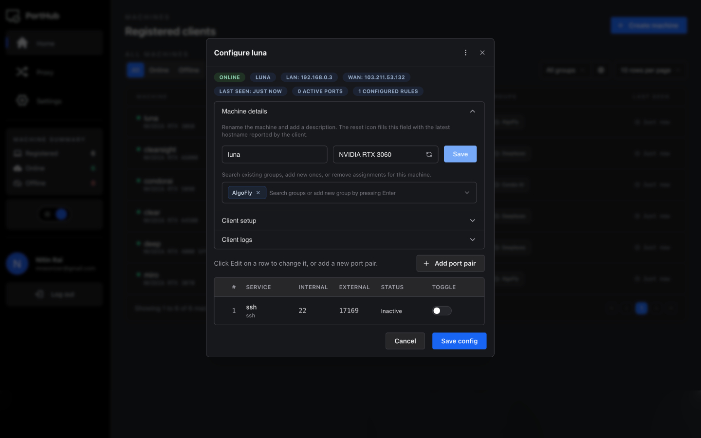
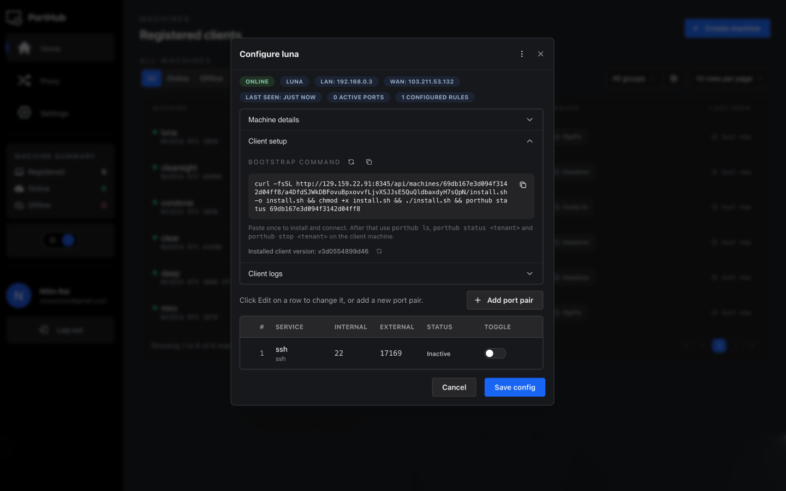
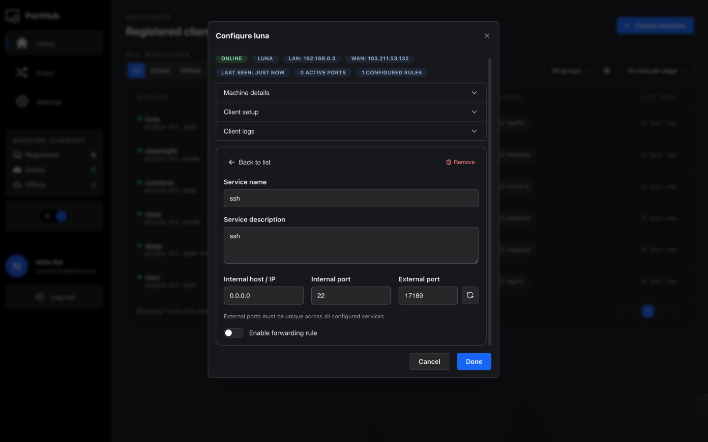

# PortHub

PortHub is a self-hosted control plane for [Rathole](https://github.com/rathole-org/rathole). It gives you a web UI and API to register machines, create forwarding rules, generate Rathole config automatically, and bootstrap remote clients with a single install command.

Instead of hand-editing `server.toml` and `client.toml` files across multiple systems, PortHub keeps the tunnel state in one place and handles the repetitive operational work for you.

## UI Preview

<p align="center">
  
  
</p>

<p align="center">
  
  
</p>

## What PortHub Handles

- Machine inventory, tokens, grouping, and status tracking
- Forwarding rules that map one public port to one machine and one local service
- Automatic generation of Rathole `server.toml` and per-machine `client.toml`
- Remote machine bootstrap for Linux (`systemd`) and macOS (`launchd`)
- Live status, config change checks, and client heartbeat flow
- Per-port IP filtering for restricting exposed services to approved source IPs
- User authentication and interactive API docs at `/api/docs`

## IP Filtering

PortHub can apply an IP filter to each forwarding rule.

- By default, a forwarded port is public.
- If you add allowed source IPs, PortHub treats that port as restricted and only those IPv4 addresses are allowed through.
- The UI exposes this in the forwarding rule editor as `IP Filter`.
- The firewall service applies the policy at the external port level and keeps recent hit / blocked-IP data for traffic monitoring.

This is backed by the Go firewall service in `server/internal/firewall/`, which stores per-port policies and programs nftables rules on the host. If firewall integration is not configured, the rest of PortHub still works, but IP filtering and firewall traffic visibility will not be available.

## Proxy Request Activity and Log Retention

The dashboard shows the five most recently requested proxy addresses. Proxy rows
show compact calendar-month (UTC) and lifetime HTTP request counts, plus the time
of the latest request. Hover for exact totals and tracking dates. Monthly counts
reset automatically; lifetime totals survive month changes. On upgrade, old
totals are assigned to a month only if their entire tracking history is within
that month; otherwise monthly tracking starts at the upgrade. Counts include bots,
assets and repeat requests: they are not unique visitors. Tracking starts when
this feature is first enabled, not when a proxy was originally created.

The API reads Traefik's shared access log read-only and atomically persists totals
with its checkpoint in MongoDB. Only registered hostnames, counts and timestamps
are retained; client IPs, paths and query strings are not copied into analytics.
Results are restricted to the authenticated account's proxies. Counters survive
API restarts and log rotation; no historical multi-gigabyte log scan is needed.

The Traefik wrapper rotates the access log at 2 MiB, checked every five seconds,
and retains one previous segment (approximately 4 MiB total plus a short burst).
Traefik reopens logs on USR1 without a restart. Docker's Traefik console logs are
also limited to two 2 MiB files. Deploy with the provided Compose files so the
rotation wrapper and read-only analytics volume are included.

## Architecture

PortHub is made of a few small pieces:

- `server/`: Go API for auth, machines, connections, private access, Socket.IO, firewall policies, and configuration generation
- `api/client/`: client bootstrap and service-management shell assets
- `ui/`: Next.js dashboard for users, machines, groups, and forwarding rules
- `proxy/certificate/`: TLS certificate Traefik uses for the app on port 8346
- `rathole`: tunnel server supervised inside the PortHub container, using the generated `server.toml`
- `server/internal/firewall/`: per-port firewall policies and traffic sampling, running inside the Go API
- `mongodb`: persistent app data
- MongoDB also stores login sessions; Redis is no longer required

## Repository Layout

```text
.
├── server/                      Go API, firewall, realtime events and background workers
├── client/                      Go tunnel, relay and private-network client
├── api/client/                  Bootstrap and tenant service management
├── ui/                          Next.js frontend
├── proxy/certificate/           TLS certificate for the app's HTTPS port
├── docker-compose.yml           The single PortHub server container
├── Dockerfile                   Server image (API, UI, MongoDB, Traefik, Rathole, firewall, relay)
├── deploy/                      Container entrypoint and process lists (Procfile.prod / .dev)
├── env.example                  Example environment configuration
└── deploy.sh                    Production app redeploy helper
```

## Running the server

PortHub runs as one container (`porthub`) with host networking. It contains
the API, the web app, MongoDB, Traefik (web proxies on 80/443 and the app on
8345/8346), the Rathole tunnel server, the firewall service and the
private-network relay, supervised by the `porthub` binary.

```bash
cp env.example .env   # set secrets; PORTHUB_MODE=prod (default) or dev
docker compose up -d --build
```

`PORTHUB_MODE=dev` runs the Go API and the Next.js dev server
from the mounted `./ui` checkout (run `yarn install` there first).

Internal services listen only on loopback ports 47001-47091. Data lives in
the `porthub_data` volume (`/data`): MongoDB, firewall state.

To move an existing multi-container installation's database into the new
container, place a `mongodump --archive --gzip` of it at
`/data/restore/mongo.archive.gz` in the volume before the first start; it is
restored once and a new MongoDB root user is created from `.env`.

## Typical Workflow

1. Create an account and sign in.
2. Add a machine and copy its generated install command.
3. Create one or more forwarding rules for that machine.
4. Optionally add an `IP Filter` allowlist for any port that should not be public.
5. Run the install command on the remote machine and let the client fetch config automatically.

The setup page provides a short machine-specific command:

```bash
curl -fsSL https://your-porthub.example/install/<short-code> | bash
```

The installer configures a persistent systemd service on Linux or a launchd
LaunchDaemon on macOS. Tenant service management currently uses the shell CLI;
public tunnels, file serving and downloads run in the bundled Go PortHub binary.
Updates install the tunnel binary as `porthub-tunnel`; old `rathole` paths are
read only until migration. Installer codes contain 16 random alphanumeric characters and expire
after 24 hours, without exposing the machine authentication token.
Server-side Rathole remains the public tunnel gateway.

Private networking is a separate, opt-in enrollment. Its short installer sets up
a native interface, workspace-only DNS, and a persistent systemd or macOS launchd
service. The Mac client uses an automatically allocated utun interface and a
managed `/etc/resolver/<workspace-suffix>` file. It adds only private peer host
routes and preserves other DNS and VPN configuration.

Clients authenticate with PortHub, download their managed `client.toml`, and
check for configuration changes. Control requests have bounded timeouts so a
stalled connection can recover. Updating a tenant refreshes its service definition
and migrates its saved API URL to the address embedded in its server's release.
Other tenants keep their own server URLs. On macOS, daemon startup errors are
written beside the tenant log in `service.log`; a loaded but crashed launchd job
is reported as stopped.

## Go API

The root `Dockerfile` is the single server build definition, explicitly selected
by `docker-compose.yml`. Run `docker compose up -d --build porthub` from the
repository root. There are no separate API, UI, or firewall Dockerfiles.

The Go API serves all routes directly, including Socket.IO, background workers,
and firewall policies. It has no Python fallback or Python runtime dependency.
OpenAPI is available at `/api/openapi.json` and Swagger UI at `/api/docs`.
See [Go API development and deployment checks](docs/go-api.md).

## Upgrading from a release that used Redis

Login sessions now live in MongoDB; Redis is no longer part of the stack.
Installations upgrading directly from an old Redis release should migrate their
sessions using that release's migration script before upgrading. The retired
script is available in Git history. Current deployments need no Redis migration.

## Runtime Notes

- Traefik serves the app on 8345/8346: `/` goes to the UI, `/api` and `/socket.io` to the API (`traefik/internal.yml`)
- The Rathole server reads `/runtime/rathole/server.toml`
- The single PortHub container uses host networking; MongoDB, the API, UI, relay, and firewall bind to separate loopback ports
- The API can run without firewall integration, but connection-level IP filtering depends on the `firewall` service being reachable

## Useful Environment Variables

- `API_SECRET_KEY`: required for API startup
- `SIGNUP_DISABLED`: disable public account creation
- `PORT_HUB_PUBLIC_BASE_URL`: canonical public URL for generated machine endpoints
- `RATHOLE_SERVER_ADDRESS`: explicit server address for remote clients
- `RATHOLE_RELEASE_GITHUB_REPOSITORY`: source repo for Rathole release downloads
- `RATHOLE_RELEASE_CACHE_TTL_SECONDS`: cache lifetime for downloaded Rathole binaries
- `MACHINE_CONFIG_LONG_POLL_TIMEOUT_SECONDS`: long-poll wait window for config change checks
- `EXTERNAL_PORT_RANGE_START` / `EXTERNAL_PORT_RANGE_END`: allowed external port range
- `FIREWALL_BASE_URL`: API URL the main backend uses to reach the firewall service
- `FW_NFT_TABLE`: nftables table name managed by the firewall service

## Why Use It

PortHub does not replace Rathole. It makes Rathole easier to operate once you have more than one machine, more than one tunnel, or stricter operational requirements around bootstrap, visibility, and access control.

Every new machine is automatically enrolled in its owner’s private network. Installation and `porthub update` install the persistent private agent; existing access rules control connectivity. Offline machines complete installation when they reconnect and update.
