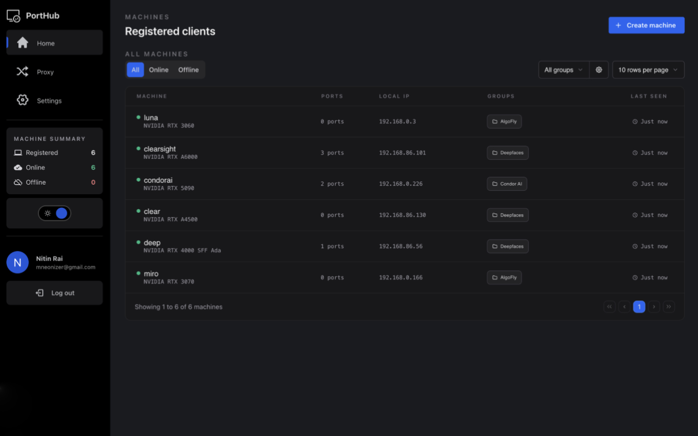

# PortHub

Self-hosted private networking, public port forwarding and a web dashboard.
PortHub is migrating its server and agent to native Rust with embedded Rathole.
The deployed Go implementation remains the behavior reference until the native
replacement passes the [migration gates](docs/rust-migration.md). The current
Rust binaries are not yet a complete replacement for registered production agents.



The native deployment uses three isolated roles: core holds the API, static UI
and MongoDB on a private container network; edge owns intentional public
listeners; firewall alone has network administration capability. Production
serves the exported UI in Rust and needs no Node runtime. See
[deployment boundaries and local verification](docs/deployment-isolation.md).

## Build and develop

Requires Docker Compose and a Linux server host. Configure `.env` from
`env.example`, including database credentials, firewall key and public URLs.

```sh
docker compose config --quiet
docker compose build core edge firewall
# Same Compose file; Next.js live editing exists only in development.
PORTHUB_MODE=dev ./deploy.sh
```

Images use `porthub:core`, `porthub:edge` and `porthub:firewall`; containers are `porthub-core`, `porthub-edge` and
`porthub-firewall`. Only edge and firewall use host networking. Internal
services communicate through separate Unix sockets, and the database has no
published port. Rathole uses `/api/tunnel` on the API's existing HTTP/HTTPS
listener, with no additional communication port.

`PORTHUB_BUILD_JOBS` bounds Cargo compilation per build stage (default four).
The packaged Linux agent is built separately with musl to avoid requiring the
server image's glibc version on client hosts.

`./deploy.sh` targets those three roles. An existing deployment additionally
requires the data/ownership, firewall and rollback steps in the migration guide;
full native parity is still pending. Do not replace a working deployment with
these partial API/agent implementations.

## Native agent tools

The Rust `porthub` binary includes HTTP serving and parallel/resumable downloads:

```sh
porthub http.server 8000 ./files
porthub http.server 9000 ./other-files
porthub http.server list
porthub http.server stop 8000
porthub http.server stop --all
porthub get https://example.com/archive.bin --connections 16 --sha256 <digest>
```

Servers can be managed from another terminal. Downloads validate resume state,
fall back to a single stream when required, and avoid overwriting existing files.
No lighttpd, aria2c, Python or package-manager dependency is required at runtime.
See [native transfers](docs/native-transfers.md) and the
[agent platform matrix](docs/agent-platforms.md). Enrollment, private networking,
service lifecycle and updater parity remain part of the migration.

## Source and checks

| Directory | Contents |
| --- | --- |
| `crates/` | Native API, agent, edge, embedded tunnel, transfers, runtime and firewall |
| `vendor/rathole/` | Pinned upstream streaming implementation and documented patches |
| `ui/` | Dashboard; static production export and development UI |
| `deploy/native/` | Structured native process configuration |
| `api/`, `client/` | Previous Go behavior reference and transition tests |

```sh
cargo check --workspace
cargo clippy --workspace --all-targets -- -D warnings
cargo test --workspace
# MongoDB integration checks require a dedicated disposable test database.
PORTHUB_TEST_MONGO_URI=mongodb://127.0.0.1:47117 cargo test -p porthub-api -- --include-ignored
node --test ui/tests/workspace.test.mjs
```

Privileged firewall tests must run in a disposable network namespace. Production
Rathole/WAN benchmarks and registered-client checks are separate rollout gates;
local unit tests do not establish their completion.
