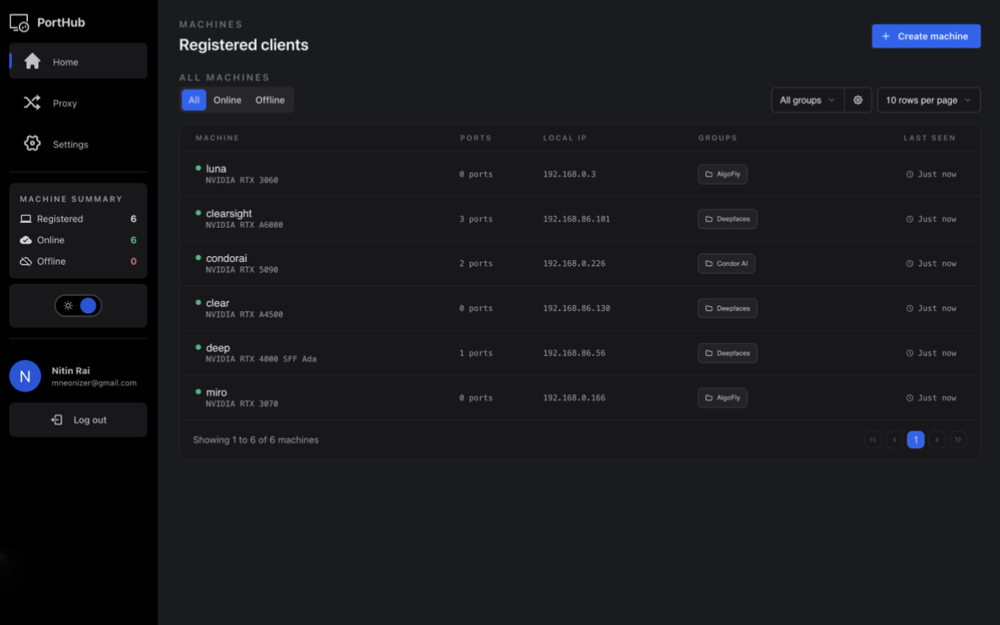

# PortHub

Self-hosted private networking, public port forwarding and a web dashboard. The
API, gateway, firewall worker and host agent are Rust; the dashboard is Next.js.



## Architecture

One Compose file runs three isolated roles:

- `porthub-core`: API, MongoDB and UI; no host networking or published ports.
- `porthub-edge`: public listeners and streaming gateway; no database access.
- `porthub-firewall`: network policy; only this role receives `NET_ADMIN`.

The roles communicate through scoped Unix sockets. Rathole-compatible forwarding
uses the existing API listeners, so it needs no extra control port. Production
images use slim runtime layers; development images also include Rust and Node
toolchains and the source needed to build inside the containers.

## Configure and run

Copy `env.example` to `.env`, set strong database and firewall credentials, and
configure the gateway URL. Runtime state is stored on the host under
`./volumes/porthub` by default; set `PORTHUB_VOLUME_ROOT` to a stable host path
when deploying from versioned source directories.

```sh
docker compose config --quiet
# Download the matching GitHub release bundle before building production images.
PORTHUB_RELEASE_BUNDLE=/path/to/verified/bundle ./deploy.sh

# Development: builds toolchains into dev-only images and syncs source into them.
PORTHUB_MODE=dev ./deploy.sh
```

Development dependencies stay in the containers; the host needs Docker Compose,
not Rust, Go or Node. Run Rust commands in a development container, for example:

```sh
docker exec -it porthub-core cargo test --workspace
```

Production keeps read-only roots and excludes build toolchains and source trees.
The default images are `porthub:core`, `porthub:edge` and `porthub:firewall`,
with the release version recorded in image labels.

## Hosted images and screenshot links

Open **Hosted images** in the portal. Paste a screenshot with Ctrl+V (Cmd+V on
macOS), drag images onto the page, or choose **Add images**. Upload starts
immediately and copies the last image's public URL. If your browser blocks
clipboard writes, use **Copy link**. Every image has a preview and a delete
control; deleting it disables its public URL. Anyone with the link can view the
raw image without signing in. Links use `/i/aB3dE.png`: five case-sensitive random
letters/digits, excluding confusing characters. A database unique index prevents
collisions; generation retries automatically, and deleting an image frees its
code for random reuse. Images remain until deleted and are stored in the
existing persistent MongoDB database, independent of the uploading machine.
Select individual rows or all images to delete them together, with a confirmation
dialog. Anonymous room visitors can only select and delete their own uploads.
Click a thumbnail for a full-screen original image: scroll or pinch to zoom,
drag to pan, double-click or use the percentage button to reset, and use arrows
to browse. New agent uploads display the authenticated machine's name; browser
uploads are marked separately. Older uploads have no recorded source.
Image pagination defaults to **Auto**, fitting rows to the available table height
as the window changes. You can still choose 10, 25, or 50 images per page.

The desktop shortcut is **disabled by default**. On GNOME-based Linux desktops,
enable automatic Ctrl+Shift+U registration from your desktop session:

```sh
porthub image shortcut enable
porthub image shortcut status
porthub image shortcut disable
# Upload manually without enabling a global shortcut:
porthub image
# URL delivery preference (per desktop user; copy is the default):
porthub image mode
porthub image mode paste
porthub image mode copy
# Override delivery for just one upload:
porthub image --mode paste
# For an agent installed with --user:
porthub image --user
# Save your preferred image-upload tenant (a unique 6+ character prefix works):
porthub image tenant list
porthub image tenant set REGISTRATION_ID
# Clear the preference; Algofly is preferred automatically:
porthub image tenant reset
# Override the saved tenant for one upload:
porthub image --registration REGISTRATION_ID
```

Tenant preferences are saved per desktop user. Without a saved preference, the
CLI prefers an installed `porthub.algofly.in` registration, otherwise the sole
available tenant. Ambiguous choices require an explicit selection. A missing or
disabled preferred tenant never silently redirects an upload to another tenant.
Browser uploads always use the portal currently open.

Paste mode also pastes the copied URL into the focused input after uploading.
Pressing the shortcut again while that image URL remains on the clipboard pastes
it again without uploading. Copy a new image to upload another screenshot.
If the active window changes during upload, PortHub leaves the URL copied and
skips automatic paste. X11 requires `xdotool`; macOS requires desktop automation
permission. Windows uses native keyboard input. Wayland currently supports copy
mode only. Clipboard delivery preferences do not enable the shortcut itself.
On X11, PortHub recognizes supported terminal applications and sends
Ctrl+Shift+V there; ordinary applications keep Ctrl+V. It waits for the shortcut
keys to be released before delivery. Paste mode never presses Enter. Image
uploads do not show native desktop notification banners.

Take a screenshot with your desktop tool so it puts the image on the clipboard,
press your shortcut, then paste the URL anywhere. The command uploads only when
invoked and preserves the clipboard if upload fails. It uses the running agent's
local authenticated broker, so desktop shortcuts do not need access to machine
credentials or elevated privileges. Update both the agent and server for this
feature. Run the command in the logged-in graphical session; headless services
cannot read a desktop clipboard. On Linux, install `wl-clipboard` for Wayland or
`xclip` for X11 so the copied URL survives the CLI exiting. Clipboard access on
Wayland also depends on compositor data-control support. Choose an unused shortcut
if your desktop already reserves Ctrl+Shift+U. macOS users can bind the command
through a Shortcuts/Automator action; Windows users can invoke it from their
preferred shortcut launcher.

Set `PORT_HUB_PUBLIC_BASE_URL` to the public HTTPS portal address so copied links
use the externally reachable gateway. With no configured base URL, clients
resolve image paths against their portal/gateway address. Hosted images accept
PNG, JPEG, WebP, and GIF up to 8 MiB and 32 megapixels; images are decoded and
published as PNG with metadata removed. Animated images use their first frame.
The resulting PNG must also fit within 8 MiB. Each account can store up to 1,000
images and 512 MiB. Uploads that would exceed the storage limit automatically
delete the oldest images in that account until there is enough space. Their
public links stop working; there is no age-based expiry. The image-count limit
still requires manual deletion. Public responses use `Cache-Control: no-store` so a deleted
image is unavailable on the next request; downloaded copies cannot be revoked.

## Public image rooms

In **Hosted images → Public rooms**, create a room and share its link. Visitors
need no account: paste an image, drop files, or choose files to upload immediately.
The latest raw image URL is copied automatically; every image and the latest URL
also have a manual **Copy link** button.

Rooms remain available until their owner deletes them. Configure the image
lifetime per room (one hour by default, between one minute and 30 days). Each
image's timer starts at upload; changing the setting affects future uploads.
Expired links stop working immediately, and MongoDB's TTL index purges expired
image data automatically. Each room has a separate 512 MiB / 1,000-image rolling
quota. Uploads remove its oldest images as needed, without touching personal
images or other rooms.

Owners can inspect and delete any images, change settings, pause/re-enable
uploads, and delete a room with all its images. Pausing does not revoke existing
image links; those continue to expire normally. Anonymous visitors can delete
only their own uploads. A cryptographically random browser ID is retained in
local storage; the server stores a room-specific hash and never includes it in
public metadata. Clearing browser storage loses anonymous deletion access.

## TCP forwarding and persistent port mappings

Forward any TCP service reachable from this machine. The target needs neither
SSH nor a PortHub agent. Private PortHub DNS names and IPs work over existing
permitted network routes; forwarding does not bypass those access rules.

```sh
# Listen on all IPv4 interfaces, on the same port as the target:
porthub forward 192.168.1.20:3000
# Bind only to localhost and use a different local port:
porthub forward peer.phub:3000 --bind localhost --local-port 8080
# Bind a specific local interface and recover after reboot:
porthub forward 192.168.1.20:3000 --host 192.168.1.10 -p 8080 -d
porthub forward ls
porthub forward status ID
porthub forward stop ID
# Exposures have the same management commands:
porthub expose 8080 --detach
porthub expose ls
porthub expose status ID
porthub expose stop ID
# Adopt already running detached exposures without interrupting them:
porthub expose recover
```

`--bind` defaults to `0.0.0.0`; `localhost` means `127.0.0.1`. Targets also
support `localhost` and bracketed IPv6 addresses. `-d`, `-D`, and `--detach` run
forwards in the background. IDs may be shortened to a unique prefix; a unique
local port also selects a mapping. Foreground forwards end when interrupted.

Detached port mappings save their desired configuration for the current OS
user and retry after worker failures or restarts. Linux uses a systemd user
service with lingering enabled, so recovery runs at boot without waiting for
login. macOS and Windows restart user mappings at login. An explicit `stop`
removes the saved configuration and prevents recovery. Gateway exposures retain
their assigned public port when reconnecting; if it is unavailable they retry
instead of silently switching ports. A forwarded target must still be reachable.
`PORTHUB_STATE_DIR` can place saved mappings in a separate state directory.
Its recovery service retains that directory setting across restarts and stays
separate from the default mapping service.
Terminal sharing and other detached tools retain their existing behavior.

## Agent development builds

The `porthub` CLI links the transfer, tunnel, mesh, egress, packet-network and
stream-lifetime libraries into one executable. `porthub-network` owns portable
packet policy/TCP termination; `porthub-io` owns tunnel cleanup. CLI and service
changes can reuse those library artifacts. Internal library versions
are independent of the CLI release; bump them when their interfaces require it.

```sh
# Fast optimized iteration, with incremental compilation and no cross-crate LTO.
cargo build --locked -p porthub-agent --profile agent-dev --timings
./target/agent-dev/porthub --help

# Shipping build retains release optimization.
cargo build --locked -p porthub-agent --release --timings
```

The first build of each profile/target is cold. Later builds still relink the
executable; edits to a dependency also rebuild its consumers. Adding Rust `mod`
files alone does not establish a separate compilation/cache boundary. Existing
libraries should be reused before introducing helper processes or embedded
executables with their own installation/update lifecycle.

GitHub platform jobs restore Cargo artifacts (including workspace libraries)
per target/toolchain. Native Linux jobs build the static musl binary in that
cached target directory through `scripts/build-agent-linux.sh`; they verify
that it has no dynamic loader and keep the existing release/checksum format.
The Docker `agent-artifacts` target remains available for local packaging. It
builds the pinned, static terminal helper and embeds it in the CLI; supported
hosts need no separate tmux installation. Helper output shares the Docker target
cache, so a Rust change can reuse the completed C build. Server binaries and
runtime images have a separate workflow; client platform jobs do not rebuild
the gateway.
CI keeps helper builds in `.cache/terminal-helper`, outside Cargo's target tree,
so Rust cache cleanup cannot remove them. Local helper builds keep their existing
`target/terminal-helper` default; set the absolute
`PORTHUB_TERMINAL_HELPER_CACHE_ROOT` to retain them independently of `cargo clean`.

Start releases from the default branch so later versions can restore the same
build caches. GitHub isolates caches written on one version tag from other tags;
merely caching a tag-only workflow does not solve reuse across releases.
Main and version-tag pushes run the continuous release workflow, which builds
and validates the complete platform bundle before publication. The explicit
publication fallback, when no automatic release is already running, is:

```sh
gh workflow run agent-platforms.yml --ref main -f platform=all -F publish_release=true
```

This builds and validates the full platform bundle before creating the release
tag, then retains the latest verified stable release plus any tags explicitly
protected in `PORTHUB_RETAIN_TAGS`. Older unprotected releases/tags and previews
are removed. Git history remains available for rebuilding an older commit.
Non-version tags and newer in-flight stable versions are preserved. Dispatch
without `publish_release` for checks or cache warming. The automatic workflow
uses pinned source revisions for both default-branch and explicit-tag builds.
CI staging artifacts expire after three days; build caches remain available for
subsequent builds, while the latest published release stays downloadable.

## Agent transfer tools

The Rust `porthub` binary includes HTTP serving, receiving, parallel downloads
and resumable directory sync:

```sh
porthub http.server 8000 ./files
porthub http.server list
porthub http.server stop 8000
porthub http.receive 8001 ./drop
porthub get https://example.com/archive.bin --connections 16 --sha256 <digest>
porthub get http://machine:8000/dataset/ --dir ./downloads
porthub push ./dataset http://machine:8001/
```

See [native transfers](docs/native-transfers.md) and the [agent platform
matrix](docs/agent-platforms.md) for details.

## Repository layout

| Path | Contents |
| --- | --- |
| `crates/` | Rust API, agent, edge, firewall, mesh, tunnel, transfer and runtime crates |
| `ui/` | Dashboard source and UI checks |
| `deploy/` | Compose runtime configuration and deployment preflight tools |
| `vendor/` | Pinned upstream Rust dependencies and documented local patches |
| `docs/` | Architecture, operations, platform support and verification records |

## Tunnel lifetime and edge health

The edge replaces closed idle data carriers automatically. Framed carriers that
stop delivering bytes expire after 60 seconds (agents send 15-second transport
heartbeats). TCP sessions stay open while both sides remain open, including
quiet SSH sessions. Once one side sends EOF, two minutes without application
reads or writes releases the connection; progressing responses can run longer.
`PORTHUB_TUNNEL_HALF_CLOSE_IDLE_SECONDS` selects 1..86400 seconds, or 0 to disable
that cleanup policy. Set it in the edge/agent process environment as needed.

Compose preserves the edge's descriptor limits (soft 65536, hard 524288).
Its real HTTP `/healthz` response reports `x-porthub-fd-used` and
`x-porthub-fd-limit`; on Linux it returns 503 at 90% of the soft limit or if
sampling fails. Applying Compose limits requires a planned container recreation.

## Checks

```sh
cargo check --workspace
cargo clippy --workspace --all-targets -- -D warnings
cargo test --workspace
node --test ui/tests/workspace.test.mjs
python3 -m unittest discover -s deploy/native -p 'test_*.py'
```

MongoDB integration checks require a dedicated disposable database. Network
benchmarks and registered-client rollout checks are recorded separately under
`docs/benchmarks/` and `docs/verification/`.
